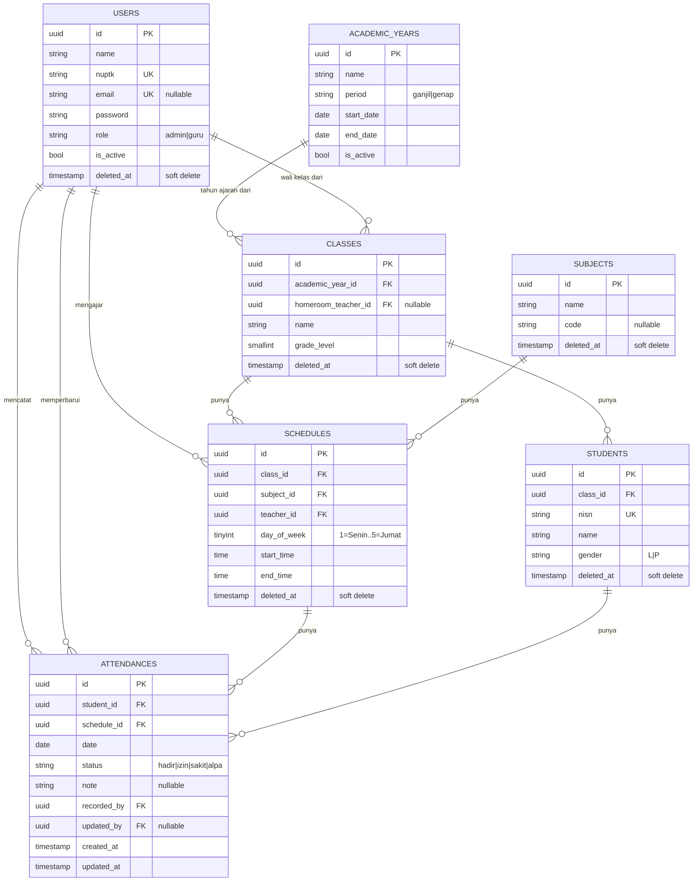

# ERD — Sistem Absensi Sekolah

Skema database untuk sistem absensi sekolah (PKM). Rujuk juga ke `PRD-Sistem-Absensi-Sekolah.md` untuk konteks fitur.

> **Skema ini sudah di-update mengikuti `docs/specs/2026-09-26-sistem-absensi-sekolah-design.md`.** Diagram di bawah adalah ringkasan visual — bentuk kolom persisnya ada di spec §3 dan itulah yang dipakai saat menulis migration.

## Catatan relasi
- `USERS.role` bernilai `admin` atau `guru`. Wali kelas bukan role terpisah — ditandai lewat `CLASSES.homeroom_teacher_id` yang mengarah ke `USERS.id`.
- Login memakai `USERS.nuptk`, bukan `USERS.email`. Email nullable dan hanya untuk kontak/arsip.
- `ACADEMIC_YEARS` membatasi rentang tanggal rekap. `CLASSES` **wajib** punya `academic_year_id` — kelas dibuat ulang tiap tahun ajaran, sehingga kelas yang sama di tahun berbeda adalah baris berbeda.
- `SCHEDULES` adalah penghubung utama: satu baris jadwal = satu kombinasi kelas, mata pelajaran, guru pengajar, hari, dan jam.
- `CLASSES.homeroom_teacher_id` **nullable** — kelas boleh dibuat sebelum wali kelas ditunjuk.
- `ATTENDANCES` adalah tabel transaksi utama, satu baris = status kehadiran satu siswa pada satu jadwal di satu tanggal. Kombinasi `student_id + schedule_id + date` bersifat unik (dijaga lewat unique constraint di migration).
- `ATTENDANCES.recorded_by` mencatat guru mana yang menginput data tersebut (bisa berbeda dari `SCHEDULES.teacher_id` kalau ada kondisi guru pengganti). `updated_by` terisi hanya kalau baris itu pernah dikoreksi.
- `ATTENDANCES` **tidak** memakai soft delete. Koreksi dilakukan dengan mengubah `status` dan mengisi `updated_by`.
- Semua tabel master memakai soft delete, supaya menghapus data master tidak ikut menghapus riwayat absensi.
