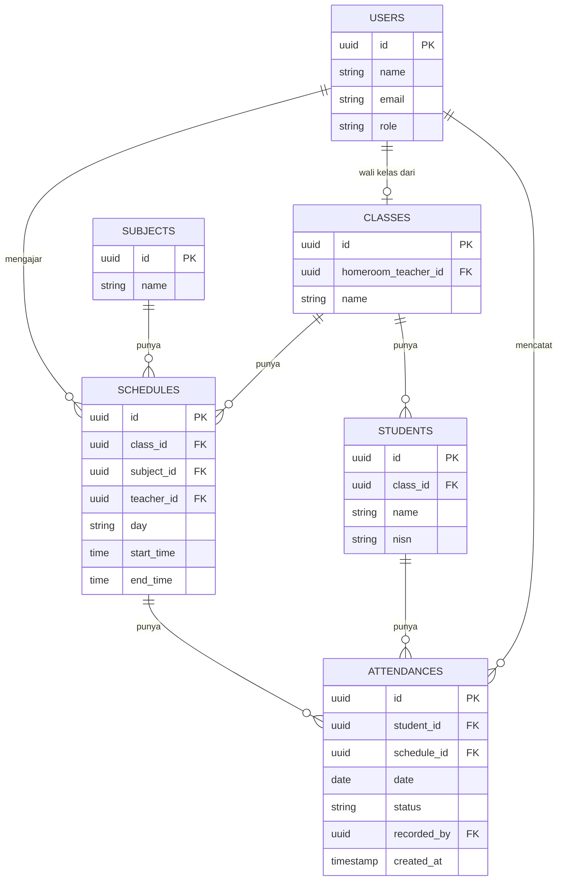

# ERD — Sistem Absensi Sekolah

Skema database untuk sistem absensi sekolah (PKM). Rujuk juga ke `PRD-Sistem-Absensi-Sekolah.md` untuk konteks fitur.

## Catatan relasi
- `USERS.role` bernilai `admin` atau `guru`. Wali kelas bukan role terpisah — ditandai lewat `CLASSES.homeroom_teacher_id` yang mengarah ke `USERS.id`.
- `SCHEDULES` adalah penghubung utama: satu baris jadwal = satu kombinasi kelas, mata pelajaran, guru pengajar, hari, dan jam.
- `ATTENDANCES` adalah tabel transaksi utama, satu baris = status kehadiran satu siswa pada satu jadwal di satu tanggal. Kombinasi `student_id + schedule_id + date` bersifat unik (dijaga lewat unique constraint di migration).
- `ATTENDANCES.recorded_by` mencatat guru mana yang menginput data tersebut (bisa berbeda dari `SCHEDULES.teacher_id` kalau ada kondisi guru pengganti).
